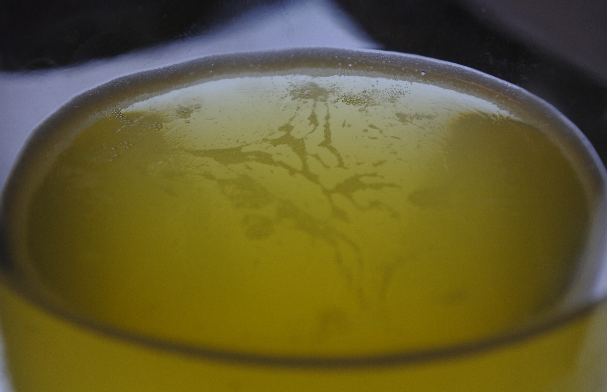
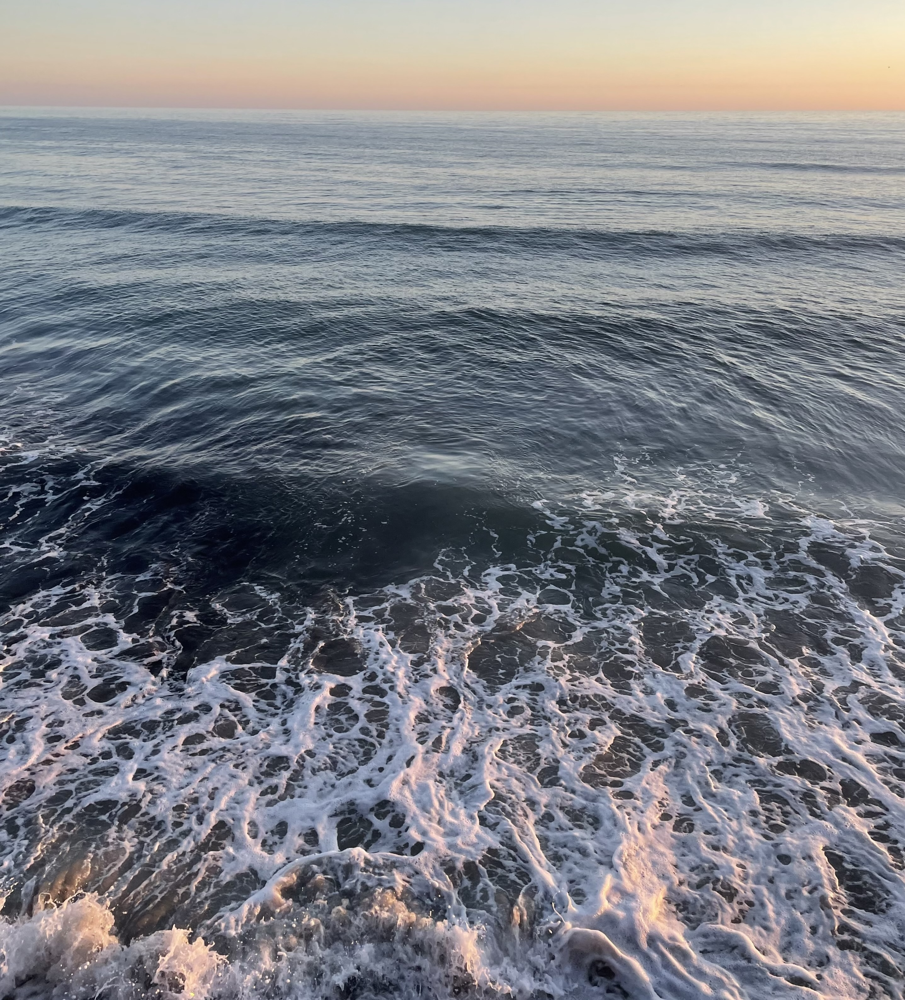
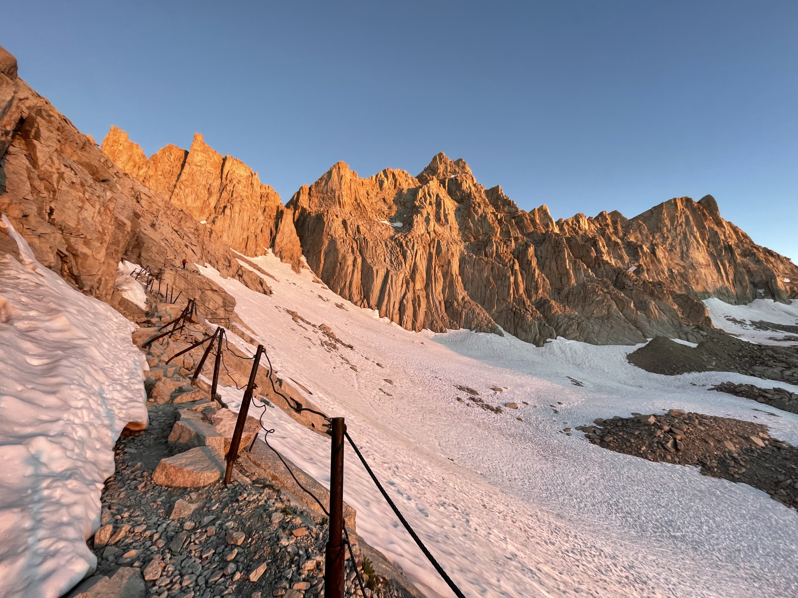
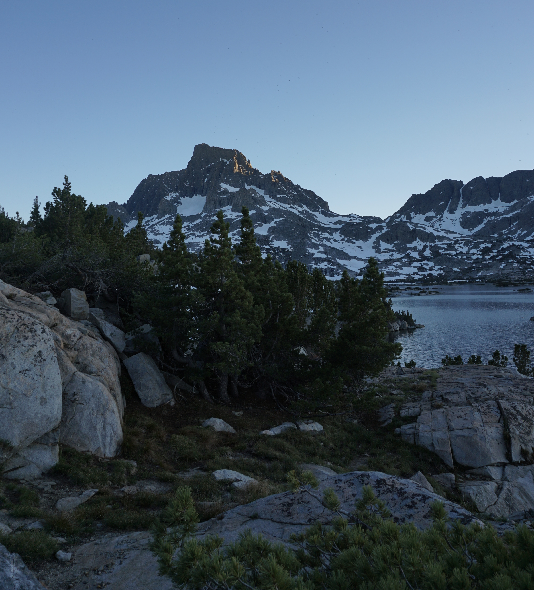

I am a senior physics major at Reed College in Portland, Oregon. I am writing my undergraduate thesis on the dynamics of beer bubbles (advised by Lucas Illing). I am interested in computational modeling and a wide range of physical problems, mostly involving geophysical fluids. As an undergraduate, I've worked on computational research in <a href="/projects/ResearchSummer2025/">cloud microphysics</a> and <a href="/projects/ResearchSummer2026/">quantum mechanics</a>.

 

I'm originally from San Diego. In my free time I enjoy snowboarding, backpacking, bouldering, and cooking. I love dogs and dabble in many other outdoor activities.

 
  
    

